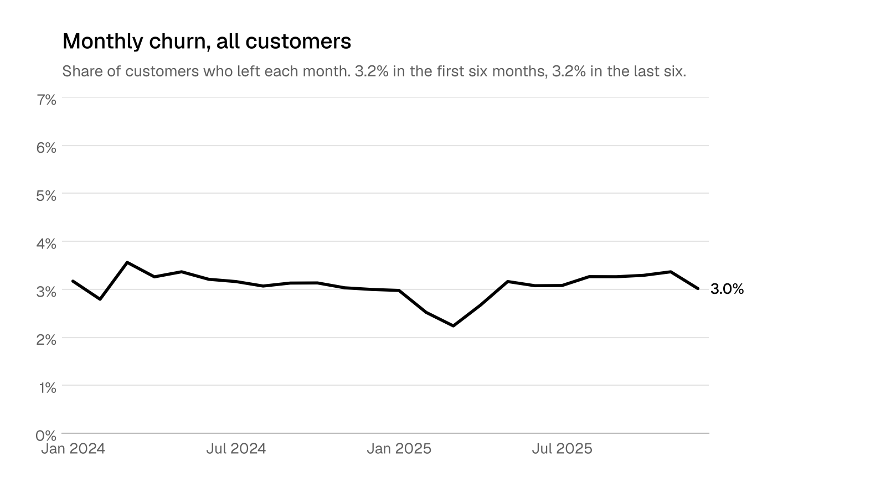
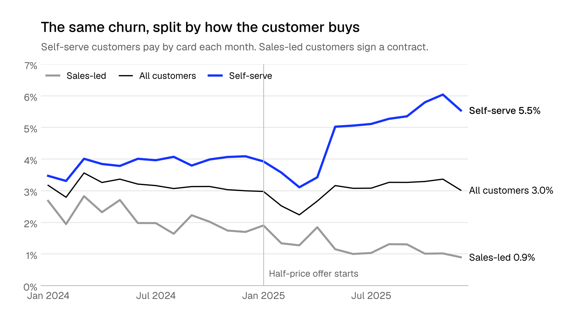
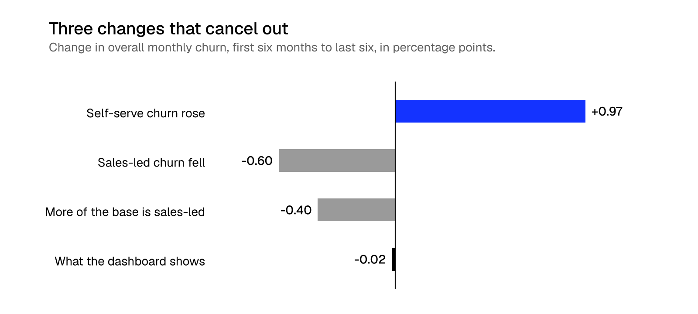
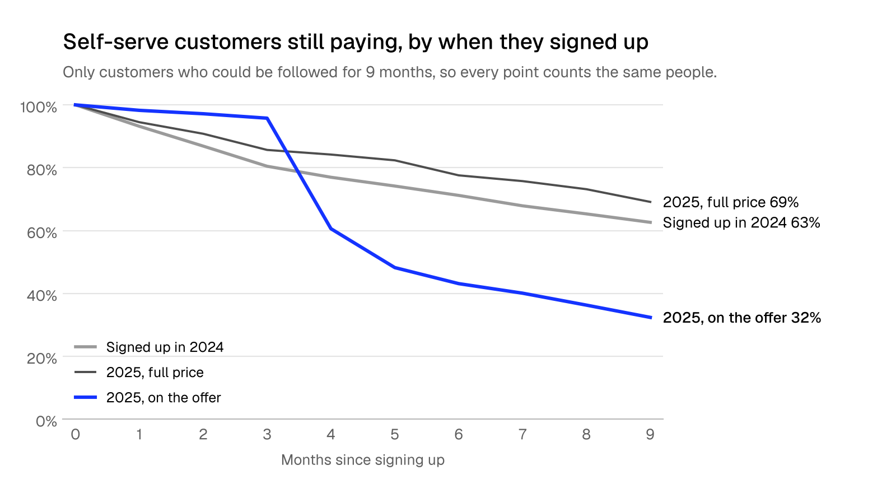
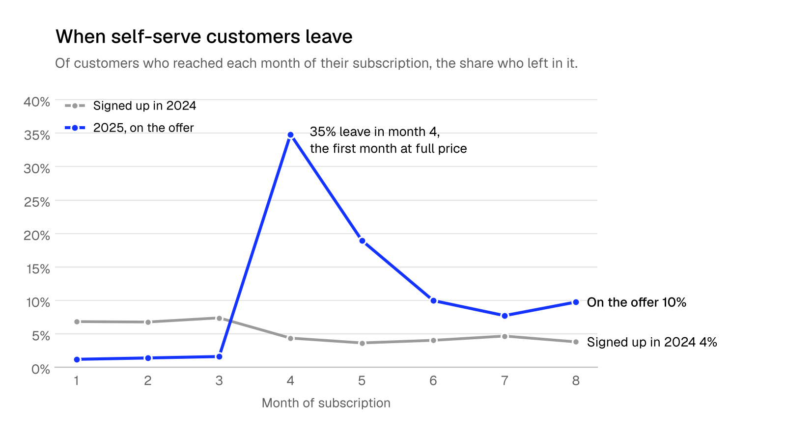
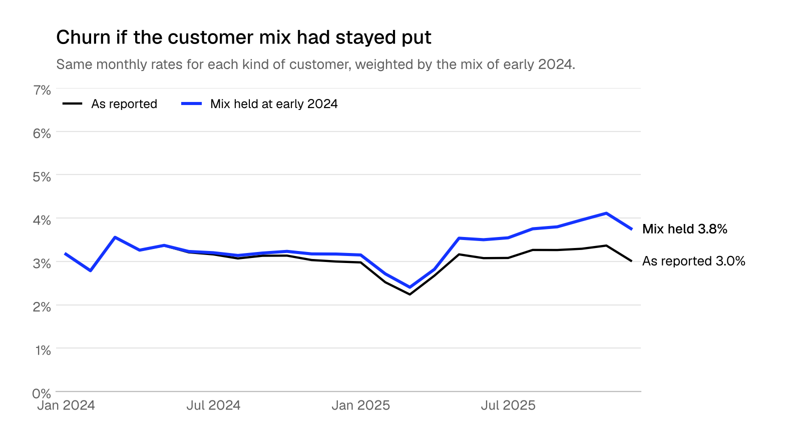

# What average churn hides

A company's monthly churn sat at 3.2% for two years. Underneath it, churn for one kind of customer went up by half, and two thirds of the customers who came in on a new offer were gone within nine months. This is a walk through how a flat number can sit on top of that, and what to look at instead.

**The data is made up.** I generated 20,575 customers of an invented subscription software company and built the problem in on purpose. [make_data.py](make_data.py) says exactly what I planted. So this is not a finding about any real business. It is a worked example of a method, on data where I know the right answer and can check that the method finds it.

Read it here, or open [analysis.ipynb](analysis.ipynb), which produces every number and chart below.

## 1. The number on the dashboard



Monthly churn here means: of the customers paying at the start of a month, the share who left during it. Over the first six months of 2024 it was 3.2%. Over the last six months of 2025 it was 3.2%. In between, the customer base more than doubled, from 5,800 to 13,522. The best month was March 2025, at 2.2%.

Anyone reading this chart would say retention is steady and had a good spring. Both of those are wrong.

## 2. Split it once

The company sells two ways. Self-serve customers sign up on the website and pay $39 a month by card. Sales-led customers sign a contract and pay about $430 a month on average.



| | First six months | Last six months |
|---|---:|---:|
| Self-serve | 3.7% | 5.5% |
| Sales-led | 2.4% | 1.1% |
| All customers | 3.2% | 3.2% |

Self-serve churn went up by almost half. Sales-led churn more than halved. Neither shows in the total.

## 3. Why the total did not move

Two things offset the self-serve problem. Sales-led customers got better at staying. And there came to be more of them: self-serve was 62% of customers at the start and 48% at the end. A total is a weighted average, so when the low-churn group grows, the total falls even if nobody behaves differently.

The change in the total splits exactly into those three pieces. The formula is the `decompose` function in [churn.py](churn.py).



Self-serve getting worse added 0.97 points. Sales-led getting better took off 0.60. The shift in mix took off 0.40. They net out to almost nothing. Without the two offsets, the dashboard would have shown churn climbing from 3.2% to about 4.2%, and somebody would have asked why.

## 4. Follow the signups, not the month

The split says where the problem is. It does not say what changed. A monthly churn rate mixes someone in their second month with someone in their fourth year. To see what changed, group self-serve customers by when they signed up and follow each group forward.



Of the self-serve customers who signed up in 2024, 63% were still paying nine months later.

In January 2025 the company started offering half price for the first three months. Of the customers who took the offer, 32% were still paying nine months later.

Customers who signed up in 2025 at full price look like the 2024 ones: 69%, on a small group of 272.

So the customers the company already had did not change. The new ones are different, and only the ones who came in on the offer.

## 5. When they leave



While the offer lasts, almost nobody leaves: 1.4% a month. In month 4 the bill goes from $19.50 to $39, and 35% leave. Another 19% of those remaining leave in month 5. For customers who signed up in 2024, month 4 is an ordinary 4.4%.

## 6. The good spring was the offer too

This is the part I find most useful, because it runs against instinct.

When the offer started, self-serve signups went from about 224 a month to about 420. For three months those new customers sat in the base and hardly any left, because they were still paying half. They made the bottom of the fraction bigger without adding to the top. Self-serve churn fell from 4.0% in late 2024 to 3.4% over the next three months, and the company-wide number had its best month on record.

So the same offer produced the best churn month in the data and then the worst ones. A monthly rate cannot tell those two apart. The cohort chart can, because it never mixes new customers with old ones.

## 7. A number that would have moved

If there is room on the dashboard for one more number, hold the mix still: take each segment's churn for the month and weight it by the customer mix of early 2024, whatever the mix is today.



Measured that way, churn over the last six months is 3.8%, against the 3.2% that was reported. This version moves when a segment's behavior moves and ignores one segment simply growing. It still has the problem from section 6, so I would put the cohort chart next to it.

## 8. Is this actually bad?

The churn numbers cannot answer that, and I do not want to pretend they can.

- **Each offer customer is worth less.** In their first nine months, a customer on the offer paid $158 on average. A 2024 signup paid $265.
- **There are a lot more of them.** A month's worth of self-serve signups in 2025 brought in about $78,800 over their first nine months. In 2024 it was about $59,200.
- **What they cost is missing.** Whether that is a good trade depends on what it costs to win and support a signup, and that is not in this data.
- **Self-serve is small in dollars.** It is 48% of customers and 7% of monthly revenue.

Someone could look at all of this and decide the offer is fine. That would be a reasonable call. The trouble with a flat 3.2% is that nobody was ever asked to make it.

## What I would put on the dashboard

1. Churn by segment, next to the total.
2. Retention by signup month for any segment that is changing.
3. The total with the mix held still.
4. How many customers are in their first three months, so a padded base is visible.

## Limits

- The data is invented and has one clean cause. Real data has several causes at once, and more noise.
- I knew which split to try. In practice that is the hard part. I would start with how the customer buys, the plan, the signup month and where the signup came from.
- Everything is counted in whole months. There are no pauses, downgrades or partial refunds.
- Apart from section 8, this counts customers and not dollars.

## Try it on your own data

`churn.py` works on any CSV with these columns: `customer_id`, `segment`, `signup_month`, `churn_month`. Months are written `2025-03`, and `churn_month` is blank for customers who are still paying.

```
pip install -r requirements.txt
python churn.py your_customers.csv
```

That prints churn by segment for the first and last six months, the three-way split from section 3, and the mix-held rate from section 7.

## Files

```
README.md          this write-up
analysis.ipynb     the notebook, with every number and chart
churn.py           the measures: monthly churn, the split, mix-held churn, retention, timing
charts.py          draws the six charts
make_data.py       generates the data, and says what was planted
data/customers.csv 20,575 made-up customers
test_churn.py      22 tests: the measures on hand-checked examples, and this page against the data
```

To rebuild everything:

```
python make_data.py
python charts.py
pytest
```
